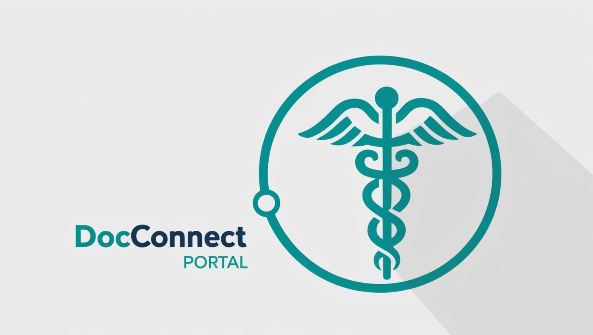

# DocConnect Healthcare Portal

An academic PHP and MySQL portal with separate patient, doctor, and administrator areas. The code includes appointment flows, records, messaging, and profile management.

## Stack

PHP, MySQL, HTML, CSS, JavaScript, and Composer packages.

## Run locally

1. Install PHP, Composer, and MySQL (or a local stack such as XAMPP).
2. Run `composer install`.
3. Import `database/schema.sql` into a local database.
4. Set `DB_HOST`, `DB_PORT`, `DB_USER`, `DB_PASSWORD`, and `DB_NAME` in your local environment to match your database.
5. Serve the folder through your local PHP web server and open `index.php`.

Patient uploads, lab results, and other user-generated files were excluded from this public portfolio copy. Only default interface images are included. Do not use the project with real patient data without a separate security review.
